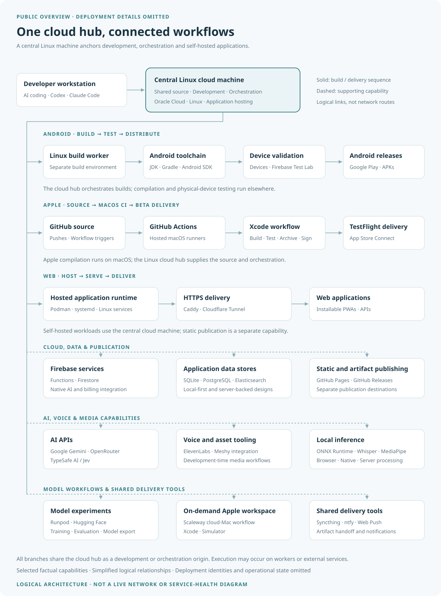

# My development ecosystem

A public overview of cloud-centered software development: Android and Apple
builds, web delivery, device testing, AI tooling, and shared services.



Open [the page](index.html) or [the vector diagram](architecture.svg).

## Architecture

A central Linux cloud machine is the shared development, orchestration, and
application-hosting hub. The diagram follows six branches:

- **Android:** a Linux build worker, Android toolchain, physical-device testing,
  Firebase Test Lab, and release outputs.
- **Apple:** GitHub source, hosted macOS runners, Xcode, and a TestFlight
  delivery workflow.
- **Web:** hosted application services, HTTPS delivery, PWAs, and APIs.
- **Cloud and data:** Firebase services, application data stores, static
  hosting, and release artifacts.
- **AI and media:** model APIs, voice and asset tools, and local inference.
- **Shared tooling:** model experiments, an on-demand Apple workspace,
  artifact handoff, and notifications.

Solid arrows show simplified build and delivery sequences. Dashed branches
show supporting capabilities used across projects. A branch does not mean
every tool runs on the central machine or that all application traffic passes
through it.

## Local preview

No build step, package installation, or account credentials are required.
Open `index.html` directly, or run:

```sh
python3 -m http.server 8000 --bind localhost
```

Open the local address printed by the server. The page includes light and
dark appearances; on small screens, the diagram scrolls horizontally so its
labels remain readable.

## GitHub Pages

The included workflow deploys updates from `main` or a manual Actions run.
After creating the GitHub repository, choose **Settings → Pages → Build and
deployment → Source → GitHub Actions**.

The workflow copies only `index.html` and `architecture.svg` into its deployment
artifact. GitHub Actions dependencies are pinned to commit hashes. No custom
domain or additional deployment secrets are needed.

## Scope and editing

Technology choices and broad workflows are factual; connections are simplified.
This is not a live network map, account-resource inventory, or service-health
report. Machine identities, access details, locations, specifications,
private projects, personal records, and operational state are omitted.

Edit `architecture.svg` to change the diagram and `index.html` to update the
surrounding page. Review SVG descriptions, HTML metadata, and Git commit
identity as well as visible content before publishing changes.

The repository contains only static HTML, SVG, and documentation, plus its
deployment workflow. It uses no scripts, external fonts, analytics, or embedded
private inventory. The ignore rules keep new files excluded until explicitly
allowed.
